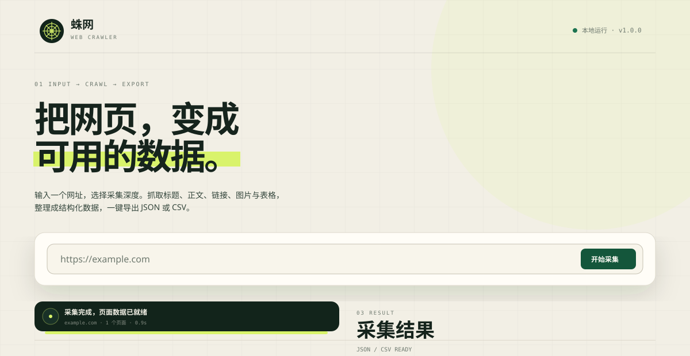

# 蛛网 · Web Crawler

[](https://github.com/wujiuyi55-sketch/spider-web-crawler/actions/workflows/tests.yml)
[](LICENSE)

一个可直接运行的本地网页采集器。输入网址，抓取标题、正文、链接、图片、表格与页面元信息，在网页里浏览结果，并导出为 JSON / CSV。



## 功能

- **网址采集**：支持 `http://` / `https://`，不写协议时自动补全 `https://`。
- **多页爬取**：采集深度 1–3 层，可限制最多 50 个页面，可只跟随同站点链接。
- **结构化提取**：标题、描述、各级标题、正文、链接（含 nofollow）、图片与 alt、表格、meta、JSON-LD。
- **网页操作台**：实时进度、当前 URL、成功/失败统计、结果筛选、页面详情弹窗。
- **实时导出**：完整结果下载为 JSON，页面概览与正文下载为 CSV。
- **礼貌抓取**：默认遵守 robots.txt，支持 `Crawl-delay`，默认 0.6 秒请求间隔。
- **安全校验**：默认禁止访问本机/内网地址，云元数据地址始终拦截，重定向逐跳校验。
- **后台任务**：采集在线程池中执行，刷新或重新打开页面后会自动恢复上次任务进度。
- **命令行模式**：不启动网页也能采集，适合写进脚本或定时任务。

## 快速开始

要求 Python 3.10+。

### Windows 一键启动

双击 `start.bat`。脚本会检查依赖，必要时执行 `pip install`，然后打开 <http://127.0.0.1:5000>。

### 手动启动

```bash
python -m pip install -r requirements.txt
python app.py --open
```

打开 <http://127.0.0.1:5000> 即可使用。

可选参数：

```bash
python app.py --host 127.0.0.1 --port 5000
```

环境变量：`CRAWLER_PORT`、`CRAWLER_HOST`、`CRAWLER_OUTPUT_DIR`、`CRAWLER_WORKERS`。

> 默认只监听本机。不要把开发服务器直接暴露到公网。

## 使用说明

1. 在输入框填入网址，例如 `https://example.com`。
2. 选择采集深度：
   - **仅当前页**：只抓输入页。
   - **一层链接**：再抓当前页里的同站点链接（默认）。
   - **两层链接**：继续向下一层。
3. 设置最多页面数与请求间隔。
4. 需要本机/局域网调试时，展开「高级设置」并勾选「允许访问内网地址」。
5. 采集完成后，点击表格行查看页面详情，或下载 JSON / CSV。

「高级设置」还可以关闭 robots.txt、允许站外链接、忽略 HTTPS 证书错误、调整请求超时。

### 采集结果的保存位置

每次任务的结果保存在 `crawls/<任务ID>/`：

```text
crawls/
└── 20261025-1a2b3c4d/
    ├── pages.json   # 完整结构化数据
    └── pages.csv    # 页面概览 + 正文
```

服务重启后内存中的任务列表会丢失，但上述文件仍在磁盘上。

## 命令行用法

```bash
# 抓取单页
python cli.py https://example.com --depth 1

# 抓取同站点两层、最多 20 页，并指定输出
python cli.py example.com --depth 3 --max-pages 20 \
  --delay 0.8 --json result.json --csv pages.csv

# 采集本机页面
python cli.py http://127.0.0.1:8000 --allow-private
```

常用参数：

| 参数 | 说明 |
| --- | --- |
| `--depth 1..3` | 采集深度，默认 2 |
| `--max-pages 1..50` | 最多页面数，默认 10 |
| `--delay` | 请求间隔秒数，默认 0.6 |
| `--timeout` | 请求超时秒数，默认 15 |
| `--any-domain` | 允许跟随站外链接 |
| `--allow-private` | 允许访问本机/内网地址 |
| `--ignore-robots` | 忽略 robots.txt |
| `--insecure` | 忽略 HTTPS 证书错误 |
| `--json PATH` / `--csv PATH` | 指定输出文件；都不指定时写入 `crawls/cli-*` |
| `--quiet` | 不打印逐页进度 |

未指定输出文件时，会同时生成 JSON 与 CSV。

## 数据字段

JSON 顶层包含 `start_url`、`pages`、`errors`、`warnings`、`skipped`、`config`、`duration_ms` 等字段。每个页面包含：

| 字段 | 内容 |
| --- | --- |
| `url` / `requested_url` | 最终 URL / 原始请求 URL |
| `status` | HTTP 状态码 |
| `depth` | 页面所在层级 |
| `title` / `description` | 标题与描述 |
| `text` | 清洗后的正文，默认最多 20,000 字符 |
| `word_count` | 中文字符数 + 拉丁词数 |
| `headings` | `[{level, text}]` |
| `links` | `[{url, text, internal, nofollow}]` |
| `images` | `[{url, alt}]` |
| `tables` | 表格标题与行列数据（最多 3 个表） |
| `meta` | meta 标签键值 |
| `structured_data` | JSON-LD 类型、名称、URL 摘要 |
| `content_hash` | 正文 SHA-256 指纹 |
| `redirected` / `redirect_chain` | 重定向信息 |
| `fetched_at` / `elapsed_ms` / `size_bytes` | 抓取时间、耗时、响应大小 |

CSV 使用 UTF-8 BOM，便于 Excel 直接打开。为避免 CSV 公式注入，以 `= + - @` 等字符开头的网页文本会加一个前导单引号。

## HTTP API

| 方法 | 路径 | 说明 |
| --- | --- | --- |
| `POST` | `/api/crawl` | 创建任务，返回 `202` 与任务信息 |
| `GET` | `/api/jobs/<id>` | 查询任务状态与进度 |
| `GET` | `/api/jobs/<id>/result` | 获取页面、错误与警告 |
| `POST` | `/api/jobs/<id>/cancel` | 请求取消任务 |
| `GET` | `/api/jobs/<id>/download/json` | 下载 JSON |
| `GET` | `/api/jobs/<id>/download/csv` | 下载 CSV |
| `GET` | `/api/health` | 健康检查 |

创建任务示例：

```bash
curl -X POST http://127.0.0.1:5000/api/crawl \
  -H "Content-Type: application/json" \
  -d '{
    "url": "https://example.com",
    "depth": 2,
    "max_pages": 10,
    "delay": 0.6,
    "same_site": true,
    "respect_robots": true,
    "allow_private": false,
    "verify_ssl": true
  }'
```

## 项目结构

```text
.
├── app.py                # Flask 服务与 API
├── cli.py                # 命令行入口
├── crawler/
│   ├── config.py         # 参数校验
│   ├── urls.py           # URL 规范化与内网防护
│   ├── fetcher.py        # HTTP 请求、重定向与大小限制
│   ├── robots.py         # robots.txt 缓存与判定
│   ├── extractor.py      # HTML 结构化提取
│   ├── engine.py         # 广度优先爬虫
│   ├── exporters.py      # JSON / CSV 导出
│   └── jobs.py           # 后台任务与结果持久化
├── templates/index.html
├── static/css/app.css
├── static/js/app.js
├── docs/preview.svg
├── tests/                # 单元与集成测试
├── .github/workflows/    # GitHub Actions 测试
├── LICENSE
└── start.bat
```

## 测试

```bash
python -m unittest discover -s tests -v
```

测试覆盖 URL 校验、内网拦截、HTML 提取、robots、深度/页数限制、后台任务、下载与 CSV 注入防护。

## 安全与边界

- 默认拒绝本机、私有网段、链路本地地址和云元数据地址。勾选「允许访问内网地址」后才可访问本机/局域网；`169.254.169.254` 等元数据地址始终拦截。
- 每次重定向都会重新校验目标 URL，避免被重定向到内网。
- 未做 DNS 固定，无法完全防御 DNS rebinding，因此不建议把服务暴露到公网。
- 只抓取服务器返回的 HTML。依赖 JavaScript 渲染、登录态或复杂反爬的页面，需要使用浏览器自动化方案另行扩展。
- 不绕过验证码、付费墙或访问控制；请遵守目标网站的 robots.txt、服务条款与当地法律。
- 这是本地工具，使用 Flask 开发服务器，不适合直接作为公网生产服务。

## 常见问题

**端口被占用？**

```bash
python app.py --port 5056
```

**为什么本机地址提示“属于内网或本机”？**

安全策略默认禁止。展开高级设置勾选「允许访问内网地址」，或在 CLI 中加 `--allow-private`。

**为什么抓不到目标内容？**

目标可能是 JavaScript 动态渲染，或内容需要登录。可先查看 JSON 中的 `text` 是否只包含骨架；本项目不执行页面脚本。

**页面显示“任务不存在或服务已重启”？**

任务状态保存在内存中，重启服务后无法恢复界面状态；但 `crawls/<任务ID>/` 下的 JSON/CSV 文件仍然保留。

## 许可证

本项目使用 [MIT License](LICENSE) 开源，Copyright © 2026 wujiuyi55-sketch。

欢迎提交 Issue 和 Pull Request。如果这个项目对你有帮助，欢迎点一个 Star。
